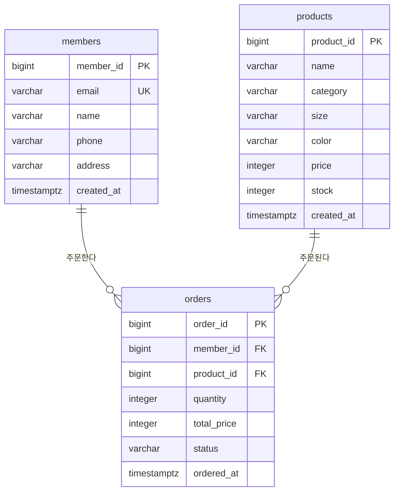

# 👕 의류 쇼핑몰 DB - Supabase CRUD 실습

의류 쇼핑몰의 **회원 / 상품 / 주문** 3개 테이블을 Supabase(PostgreSQL)에 만들고,
Python으로 CRUD(등록·조회·수정·삭제) 기능을 구현한 콘솔 프로그램입니다.

## 🛠 사용 기술
- Python 3.14
- [uv](https://docs.astral.sh/uv/) (프로젝트/패키지 관리)
- Supabase (`supabase` 파이썬 라이브러리)
- python-dotenv (환경변수 관리)

## 📁 폴더 구조
```
shopping-mall-db-supabase/
├── sql/
│   └── schema.sql      # 테이블 생성 + 샘플 데이터 SQL
├── images/             # README 캡처 이미지
├── db.py               # Supabase 연결
├── member.py           # 회원 CRUD
├── product.py          # 상품 CRUD
├── order.py            # 주문 CRUD
├── main.py             # 콘솔 메뉴 (실행 파일)
├── .env.example        # 환경변수 예시
└── pyproject.toml
```

---

## 🗂 테이블 설계

### ERD


- 회원 1명은 여러 개의 주문을 할 수 있습니다. (members 1 : N orders)
- 상품 1개는 여러 주문에 포함될 수 있습니다. (products 1 : N orders)
- 회원이나 상품이 삭제되면 관련 주문도 같이 삭제됩니다. (`ON DELETE CASCADE`)

### 1. members (회원)
| 컬럼명 | 타입 | 제약조건 | 설명 |
|---|---|---|---|
| **member_id** | bigint | **PK**, 자동 증가 | 회원 번호 |
| email | varchar(100) | NOT NULL, UNIQUE | 이메일 |
| name | varchar(50) | NOT NULL | 이름 |
| phone | varchar(20) | | 전화번호 |
| address | varchar(200) | | 배송 주소 |
| created_at | timestamptz | DEFAULT now() | 가입일 |

### 2. products (상품)
| 컬럼명 | 타입 | 제약조건 | 설명 |
|---|---|---|---|
| **product_id** | bigint | **PK**, 자동 증가 | 상품 번호 |
| name | varchar(100) | NOT NULL | 상품명 |
| category | varchar(30) | NOT NULL | 카테고리 (상의/하의/아우터) |
| size | varchar(10) | NOT NULL | 사이즈 (S/M/L/XL) |
| color | varchar(20) | | 색상 |
| price | integer | NOT NULL, CHECK (price >= 0) | 가격 |
| stock | integer | NOT NULL, DEFAULT 0, CHECK (stock >= 0) | 재고 |
| created_at | timestamptz | DEFAULT now() | 등록일 |

### 3. orders (주문)
| 컬럼명 | 타입 | 제약조건 | 설명 |
|---|---|---|---|
| **order_id** | bigint | **PK**, 자동 증가 | 주문 번호 |
| *member_id* | bigint | **FK** → members(member_id), NOT NULL | 주문한 회원 |
| *product_id* | bigint | **FK** → products(product_id), NOT NULL | 주문한 상품 |
| quantity | integer | NOT NULL, CHECK (quantity > 0) | 수량 |
| total_price | integer | NOT NULL | 총 금액 (가격 × 수량) |
| status | varchar(20) | NOT NULL, DEFAULT '주문완료' | 주문 상태 |
| ordered_at | timestamptz | DEFAULT now() | 주문일 |

> 테이블 생성 SQL 전체는 [`sql/schema.sql`](sql/schema.sql) 에 있습니다.

### Supabase Table Editor 캡처
<!-- Supabase 대시보드 > Table Editor 화면을 캡처해서 images 폴더에 넣어주세요 -->
| members | products | orders |
|---|---|---|
|  |  |  |

---

## ✅ 구현한 CRUD 기능

| 테이블 | Create | Read | Update | Delete |
|---|---|---|---|---|
| 회원 | 회원 등록 | 전체 조회 | 전화번호/주소 수정 | 회원 삭제 |
| 상품 | 상품 등록 | 전체 조회, 카테고리별 조회 | 가격/재고 수정 | 상품 삭제 |
| 주문 | 주문 등록 (재고 확인 + 재고 차감) | 전체 조회(회원명·상품명 JOIN), 회원별 조회 | 주문 상태 변경 | 주문 삭제 |

### 코드 예시 (회원 등록)
```python
def create_member(email, name, phone, address):
    data = {"email": email, "name": name, "phone": phone, "address": address}
    response = supabase.table("members").insert(data).execute()
    return response.data
```

### FK를 활용한 조회 (주문 + 회원 이름 + 상품 이름)
```python
supabase.table("orders").select("*, members(name), products(name)").execute()
```

---

## 📸 CRUD 동작 화면

### 1. Create (등록)


### 2. Read (조회)


### 3. Update (수정)


### 4. Delete (삭제)


---

## ▶ 실행 방법

1. 저장소 클론 후 패키지 설치
   ```bash
   git clone https://github.com/gyoo303/shopping-mall-db-supabase.git
   cd shopping-mall-db-supabase
   uv sync
   ```
2. Supabase 프로젝트 생성 → **SQL Editor** 에서 `sql/schema.sql` 실행
3. `.env.example` 을 복사해서 `.env` 파일을 만들고 값 입력
   ```
   SUPABASE_URL=https://your-project-id.supabase.co
   SUPABASE_KEY=your-supabase-anon-or-publishable-key
   ```
4. 프로그램 실행
   ```bash
   uv run main.py
   ```

## 💡 배운 점
- PK / FK 를 설정하면 테이블 간 관계가 생기고, Supabase에서는 `select("*, members(name)")` 처럼 JOIN 결과를 쉽게 가져올 수 있다.
- `ON DELETE CASCADE` 를 쓰면 부모 데이터 삭제 시 자식 데이터도 함께 삭제된다.
- API 키는 `.env` 에 저장하고 `.gitignore` 에 추가해서 GitHub에 올라가지 않도록 해야 한다.
